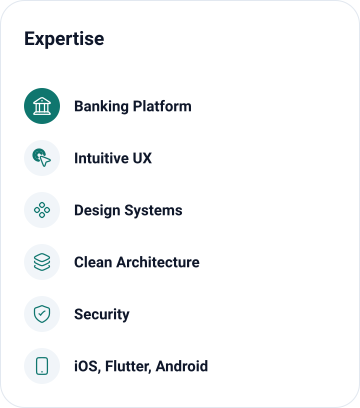

# Candra Prasetya

<picture>
  <source media="(prefers-color-scheme: dark)" srcset="assets/expertise-dark.svg">
  
</picture>

I work on banking platforms, where I care most about intuitive UX, immersive
interfaces, and UI that stays clean and consistent. The three things I am strict
about are the design system, clean architecture, and security, because most code
is written by AI now and those are the parts that decide whether it holds up.

## Where the attention goes

- **Design system** : every screen drawn from the same tokens and components, so the product reads as one product instead of twelve.
- **Clean architecture** : boundaries that keep features replaceable, and no boilerplate where a small abstraction should do the work.
- **Security** : the requirement AI is least able to decide on its own.

## What I build

- **Banking Platform** : core flows where correctness, audit trails, and regulated data shape the design.
- **UI / UX** : intuitive navigation and immersive interfaces, checked against the design system before they ship.
- **Mobile** : iOS, Flutter, and Android, from prototype to store.
- **Tender projects** : delivered for Kardusinfo.

&nbsp;&nbsp;&nbsp;&nbsp;

